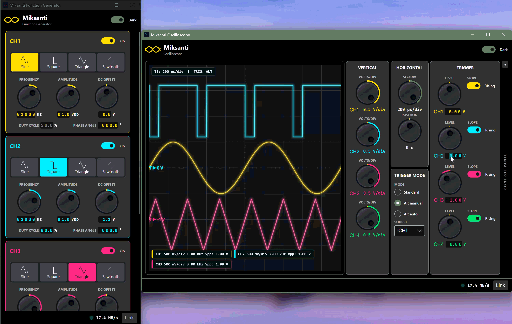
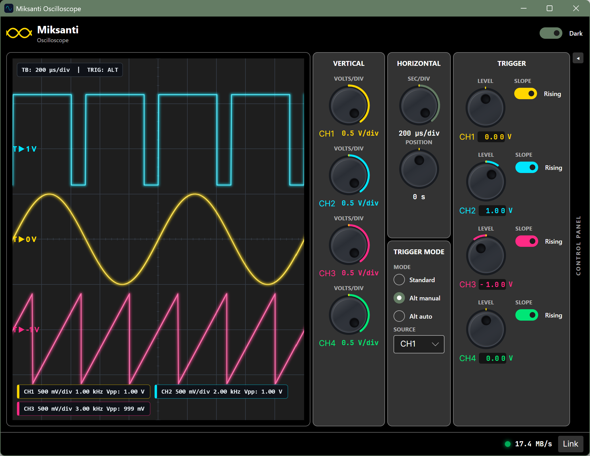
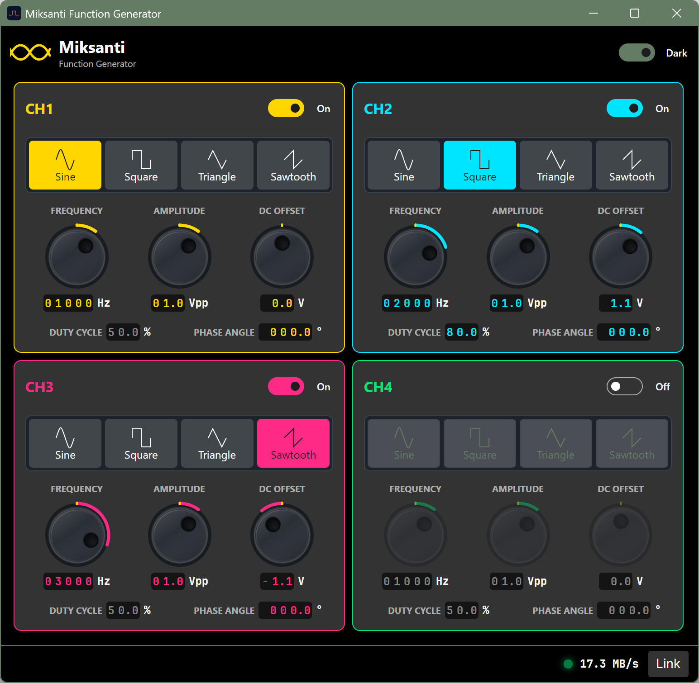
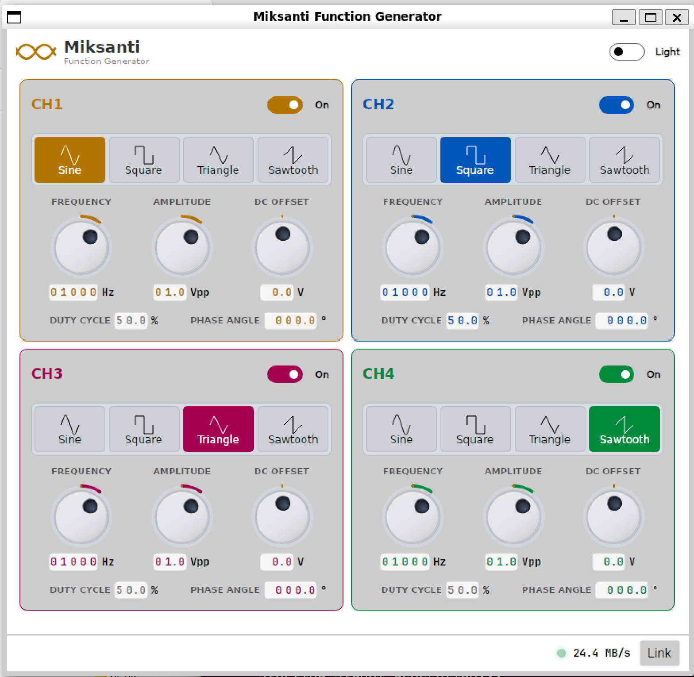
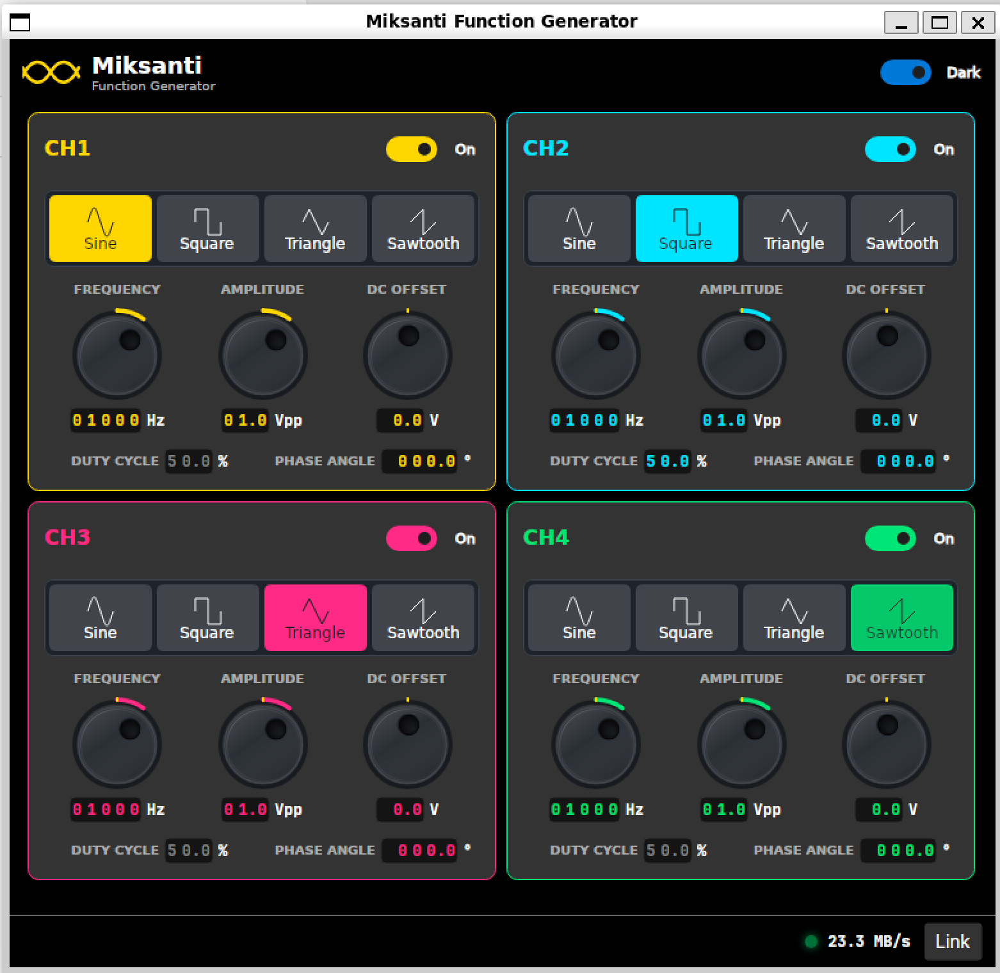

# Signal Explorer Suite

**A high-performance, cross-platform scientific instrumentation desktop suite built with C# .NET 10/11, Avalonia UI 12, and SkiaSharp.**

---

## Overview

**Signal Explorer Suite** is a real-time, multi-application desktop instrumentation platform comprising a **Headless Signal Generator Console Engine** and a full **4-Channel GUI Suite (Signal Generator & Digital Oscilloscope)**. Designed from first principles for deterministic performance and responsive cross-platform UI, the suite streams high-frequency waveform telemetry over UDP with sub-millisecond rendering latency.

Built through an **AI-First engineering workflow** in collaboration with Gemini, this project demonstrates how modern systems architecture, zero-allocation memory pipelines, and GPU-accelerated vector graphics come together in modern .NET desktop development.

---

## Architecture & Evolutionary Design

The project was engineered using a decoupled, headless-first philosophy:

1. **Phase 1: The Headless Console PoC (`SignalGenerator.Console`)**
   * Built as an initial proof of concept to validate core digital signal processing (DSP) synthesis, multi-channel sample timing, and low-overhead UDP packet framing without UI overhead.
   * Serves as a robust, lightweight telemetry broadcaster capable of driving the oscilloscope independently for headless testing and benchmarking.
2. **Phase 2: The GUI Suite (`SignalExplorerSuite`)**
   * Expanded into a full-fledged cross-platform desktop application powered by Avalonia UI 12 and SkiaSharp, pairing the telemetry engine with custom controls and real-time GPU rendering.

---

## Core Components

### 🖥️ Headless Signal Generator (Console App)
* **Standalone Telemetry Broadcaster:** Operates entirely without a GUI, ideal for background daemon execution, automated testing, and low-resource environments.
* **Configurable Waveform Synthesis:** Programmatic control over frequency, amplitude, phase offset, and channel mapping via command-line arguments or configuration bindings (`System.CommandLine`).
* **Zero-Allocation Socket Layer:** Optimized UDP packet serialization designed to sustain high-frequency burst rates without triggering garbage collection overhead.

### 📡 4-Channel GUI Signal Generator
* **Interactive Multi-Channel Control:** Real-time waveform adjustments across four independent channels through custom-engineered Avalonia controls.
* **Custom UI Engineering:** Includes purpose-built components like validated IPv4 addressing (`IpAddressTextBox`), thumbwheel control, and high-precision numeric stepper (`DigitScrubber`) templated control.

### 📈 4-Channel Digital Oscilloscope
* **GPU-Accelerated Waveform Rendering:** Custom `SkiaSharp` rendering pipeline featuring a high-performance custom canvas rendering pipeline utilizing multi-pass layer blending and alpha-decay accumulation for authentic phosphor-glow persistence.
* **Hardware-Style Triggering:** Responsive edge-triggering engine supporting configurable trigger levels, slopes, and channel sources for rock-solid waveform stabilization.
* **Fluid Cross-Platform UX:** Smooth, 60+ FPS pan, zoom, and timebase scaling across Windows, Linux and macOS desktops.

---

## Systems Architecture & Engineering Highlights

This suite was architected with a strict focus on **mechanical sympathy** and **zero-allocation hot paths** to ensure the UI thread remains completely decoupled from high-frequency data ingestion:

* **Zero-Allocation Data Pipeline:** Extensive use of `Span<T>`, `ReadOnlySpan<T>`, `MemoryMarshal`, and `ArrayPool<T>` eliminates garbage collection (GC) pauses during continuous high-rate telemetry streaming.
* **Lock-Free Concurrency:** Bounded `System.Threading.Channels` decouple the UDP socket listener, DSP/trigger processing stage, and the Avalonia UI rendering loop.
* **Custom Avalonia UI 12 Controls:** Engineered custom templated and direct-rendered controls from scratch—avoiding heavy third-party UI bloat while maintaining native theming, DPI awareness, and cross-platform consistency.
* **Modern .NET 10 Toolchain:** Structured with Central Package Management (`Directory.Packages.props`), `.slnx` solution architecture, and Native AOT readiness.

---

## Technology Stack

| Layer | Technology |
| :--- | :--- |
| **Runtime & Language** | .NET 10, C# 13 |
| **CLI & Parsing** | `System.CommandLine` |
| **UI Framework** | Avalonia UI 12 (Cross-Platform Desktop) |
| **2D Graphics Engine** | SkiaSharp (GPU-Accelerated Custom Drawing) |
| **Transport & Concurrency** | System.Net.Sockets (UDP), `System.Threading.Channels` |
| **Memory & Performance** | `Span<T>`, `MemoryMarshal`, `ArrayPool<T>` |

---

## Screenshots

### Multi-Channel Oscilloscope & Triggering

### Signal Generator GUI & Custom Controls

### Signal Generator on Linux

---

## AI-First Development Methodology

Signal Explorer Suite was architected and built using an **AI-First collaborative workflow** with Google Gemini. Rather than relying on boilerplate code generation, AI was utilized as an architectural sounding board and systems-engineering partner—accelerating rapid prototyping of direct GPU-accelerated 2D rasterization via SkiaSharp's surface management, avoiding managed heap allocations during the render loop by reusing SKPaint and SKPath instances, validating lock-free ring-buffer and channel topologies, and stress-testing cross-platform Avalonia layout behaviours.

---

## Architecture & Source Inquiries

*Note: This repository serves as the public showcase, architectural overview, and release hub for the Signal Explorer Suite. Core source code is maintained in a private repository.*

If you are an engineering lead, technical recruiter, or prospective client interested in discussing the architecture, custom Avalonia UI development, or reviewing specific code samples, please feel free to reach out directly via LinkedIn or email.
